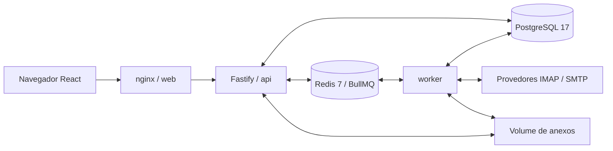

# Arquitetura do APMail

O PostgreSQL é a fonte da verdade. Redis organiza execução e tempo real; jobs perdidos serão reconstruídos a partir do banco. Pacotes shared não usam módulos Node; db é exclusivo do servidor.

As sete filas usam prefixo `apmail`: mailbox-sync, mailbox-connection, outbox-send, mail-actions, rules-apply, system-email e maintenance. As salas Socket.IO serão autorizadas por sessão e recurso: user, tenant, mailbox, thread e chat.

Migrations SQL são aplicadas em transações com lock exclusivo e checksum imutável. Segredos locais não entram no Git. A infraestrutura nova usa recursos Docker exclusivos.

O ambiente /admin compartilha sessão, empresa, cache, socket e transferências com o e-mail. A API filtra cada seção administrativa por permissão. Domínios/diagnósticos são metadados por empresa; identidades de mensagens resolvem conversas independentemente das filas. A política de apresentação pertence à empresa e o recálculo com geração/checkpoint é executado na fila maintenance.

O acesso operacional a e-mails exige vínculo explícito em `mailbox_members`, inclusive para administradores e proprietários da empresa. Ausência de vínculo significa **Sem acesso**; o papel e as restrições de pastas são respeitados pela API, buscas, notificações e jobs. **Admin da caixa** e **Supervisor** podem acompanhar todos os atendimentos da caixa autorizada. A configuração administrativa usa consultas `configuration=true`, protegidas e com cache separado: permite gerenciar conexões e concessões sem liberar leitura de mensagens; a árvore de configuração não inclui contadores de e-mails. Não há concessão automática nem alteração dos acessos existentes ao publicar essa regra. Os painéis privilegiados de auditoria e retenção continuam sujeitos às suas permissões específicas.

O atendimento usa os status existentes das conversas. `service_started_at` registra o início por ação explícita ou rascunho, independentemente de `assigned_to`. A configuração de filas é por caixa e a migração inicial replica a preferência anterior de cada empresa. Caixas existentes começam como globais. Caixas individuais exigem um dono ativo com acesso à própria caixa e permissão de envio. A atribuição automática é aplicada a novos recebimentos, preservando responsáveis já definidos.

O Supervisor tem visão geral da caixa e pode atribuir atendimentos. O Operador mantém o papel `editor` no banco e, quando a restrição da empresa está ativa, só vê conversas atribuídas a ele ou cobertas por convite ativo. Convites concedem acesso temporário à conversa original, incluindo resposta e anexos relacionados, e são encerrados na conclusão ou revogação. Auditoria e retenção têm permissões administrativas próprias.
